# AquaPlan – System Architecture

This document describes how AquaPlan is organised: the parts of the system, how they talk to each
other, how data is stored in MockAPI, and what happens step by step for the main user actions.

> **Viewing the diagrams:** the diagrams use **Mermaid**. GitHub renders them automatically. In VS Code,
> install the extension **"Markdown Preview Mermaid Support"** (by Matt Bierner), then press
> `Ctrl+Shift+V` to open the preview. You can also paste any diagram into https://mermaid.live.

Related documents: [REQUIREMENTS.md](REQUIREMENTS.md) · [EXPLANATION.md](EXPLANATION.md) · [MOCKAPI_SETUP.md](MOCKAPI_SETUP.md)

---

## 1. Architecture at a glance

AquaPlan is a **client-only single-page application**. All application logic (routing, validation,
irrigation calculations, rendering) runs **in the user's browser**. There is no custom server.
Two external services are used:

| Service | Role | Auth | Data direction |
|---|---|---|---|
| **Open-Meteo Geocoding** | Place name → latitude/longitude | None | Read only |
| **Open-Meteo Forecast** | Past and forecast rain + ET₀ | None | Read only |
| **MockAPI.io** | Stores `fields` and `records` (our "database") | None (public URL) | Read + write |

Key design choices:
1. **Layered code:** UI (views) → services (API wrappers, models) → external APIs. Each layer only calls the layer below it.
2. **Pure calculation core:** `js/models/` has no DOM or `fetch`, so it is easy to test.
3. **Store inputs, compute outputs:** MockAPI holds only what the user entered. Deficits, depths and plans are recalculated on every view.
4. **Hash routing:** one `index.html`. The `#/...` part of the URL decides which view is shown.

---

## 2. System context diagram

Who and what interacts with AquaPlan.

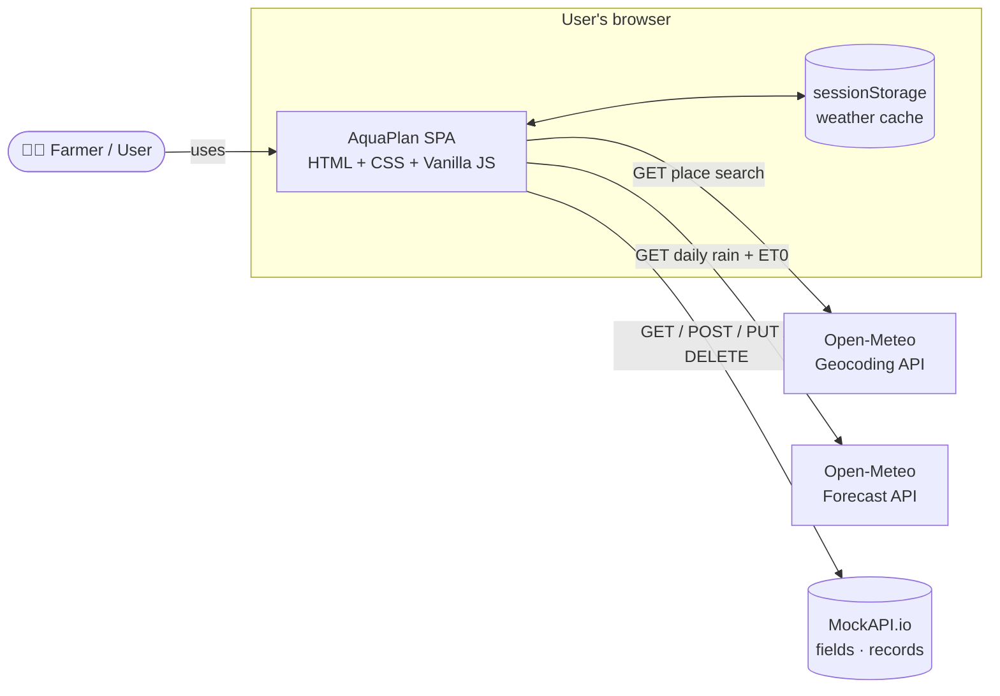

---

## 3. Deployment diagram

Where each piece runs.

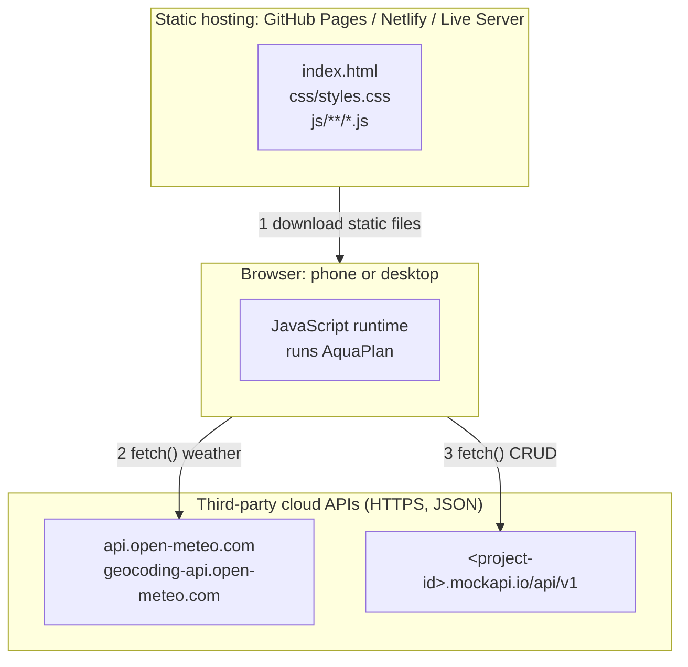

The host only serves files; it runs no code. All requests to Open-Meteo and MockAPI go **directly
from the browser** to those services (both allow cross-origin requests).

---

## 4. Layered (logical) architecture

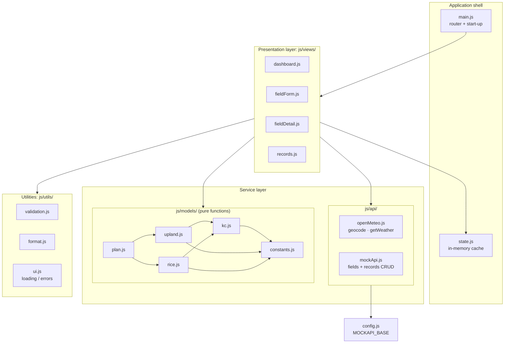

### Module responsibilities

| Module | Responsibility | May use | Must NOT use |
|---|---|---|---|
| `main.js` | Listens for `hashchange` and calls the matching view | views | fetch directly |
| `views/*` | Build HTML, handle events, call services, show loading/errors | api, models, utils, state | — |
| `api/openMeteo.js` | Build Open-Meteo URLs, fetch, reshape arrays into day objects, cache | config, `sessionStorage` | DOM |
| `api/mockApi.js` | One function per CRUD action, throw on non-2xx | config | DOM |
| `models/*` | Kc, water balance, projection, plan statuses | constants | DOM, fetch, storage |
| `utils/validation.js` | Return `{field: message}` error maps | — | fetch |
| `utils/format.js` | mm ↔ m³, cm ↔ mm, date formatting | — | — |
| `utils/ui.js` | Spinner, error banner, empty state, HTML escaping | DOM | fetch |
| `state.js` | Hold the last-loaded fields/records so the UI doesn't refetch on every click | — | — |

---

## 5. Routing map

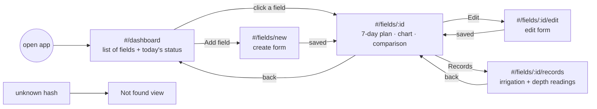

---

## 6. Data architecture (MockAPI)

### 6.1 Entity-relationship diagram

One **field** has many **records**. A record is either an irrigation event or a rice depth reading.

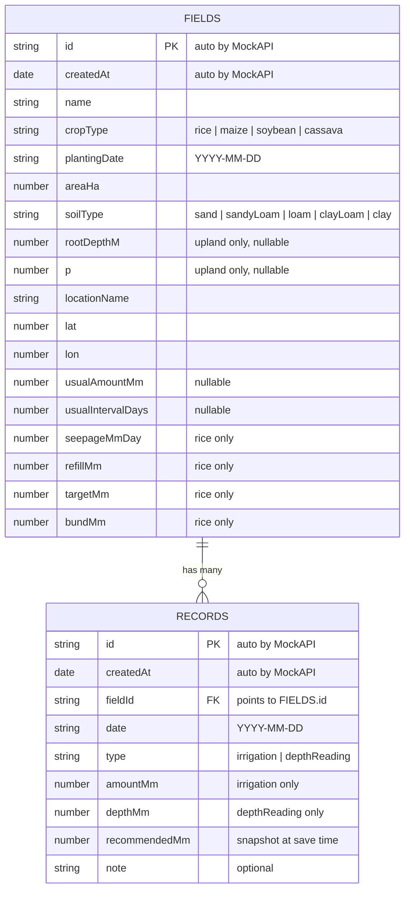

### 6.2 What is stored vs what is calculated

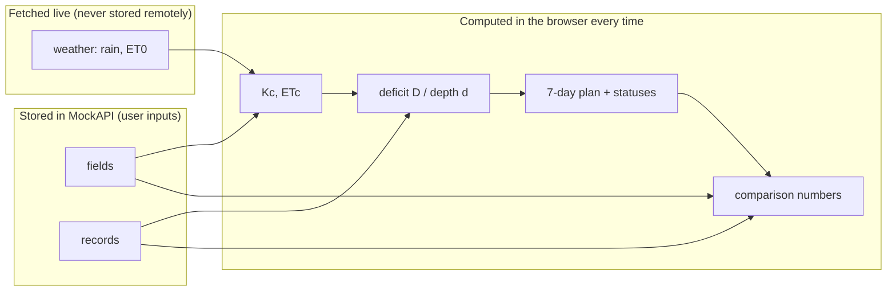

Because derived values are never saved, editing or deleting a record can never leave the stored
data inconsistent. The next page load simply recalculates.

### 6.3 Endpoint map

Base URL: `https://<project-id>.mockapi.io/api/v1`

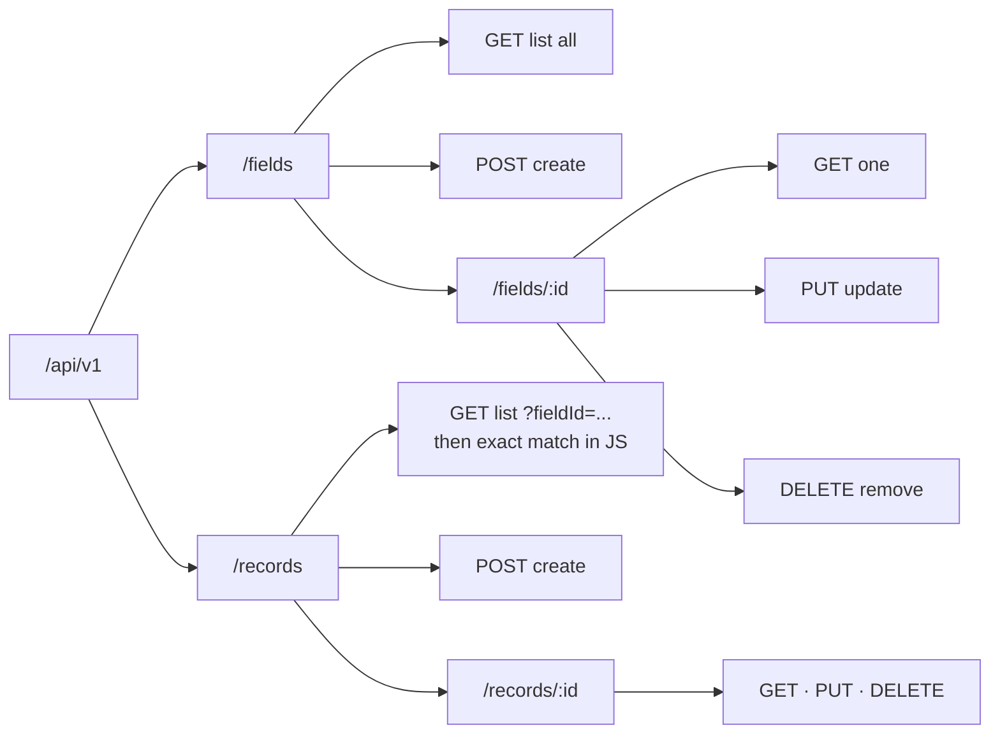

| Method | Path | Body | Success | Used by |
|---|---|---|---|---|
| GET | `/fields` | – | 200 + array | dashboard |
| GET | `/fields/:id` | – | 200 + object | detail, edit form |
| POST | `/fields` | field JSON (no id) | 201 + created object | new form |
| PUT | `/fields/:id` | full field JSON | 200 + updated object | edit form |
| DELETE | `/fields/:id` | – | 200 + deleted object | detail (after deleting its records) |
| GET | `/records?fieldId=:id` | – | 200 + array (**filter exactly in JS**, see MOCKAPI_SETUP §7) | detail, records |
| POST | `/records` | record JSON | 201 | records |
| PUT | `/records/:id` | full record JSON | 200 | records |
| DELETE | `/records/:id` | – | 200 | records |

---

## 7. Key interaction sequences

### 7.1 Create a field (with location search)

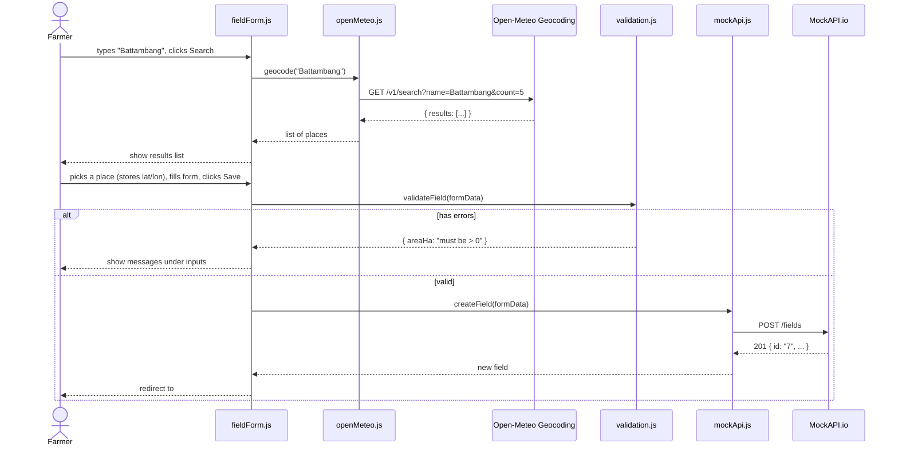

### 7.2 Open a field's detail page (the main flow)

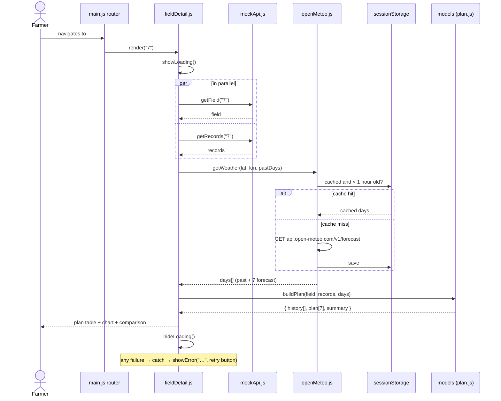

### 7.3 Add an irrigation record

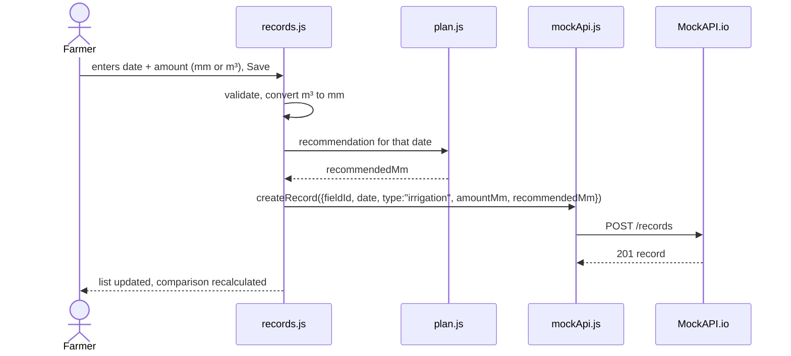

### 7.4 Delete a field (manual cascade)

MockAPI does not delete child data automatically when used with a flat `records` resource, so the app does it:

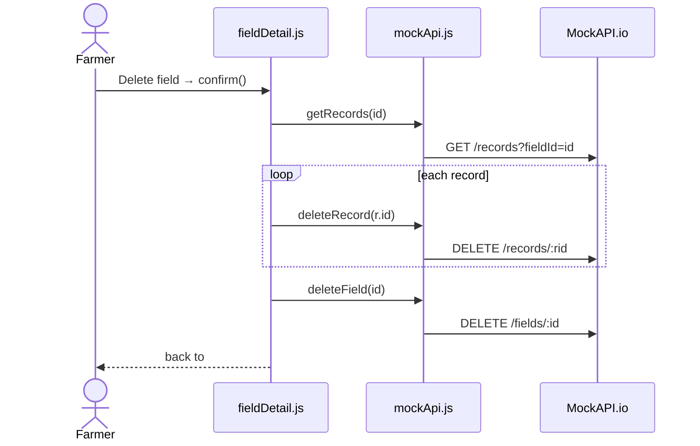

---

## 8. Calculation pipeline

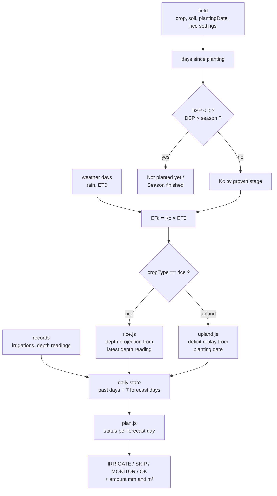

### Daily status decision

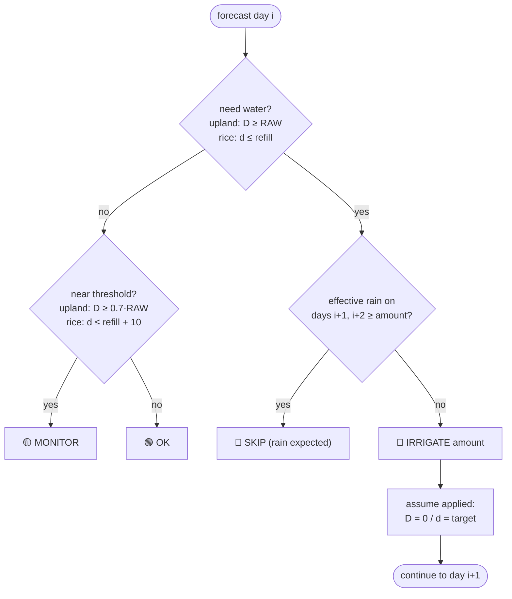

---

## 9. Error handling strategy

| Failure | Where caught | What the user sees |
|---|---|---|
| No internet / DNS failure (`fetch` rejects) | view `try/catch` | "You appear to be offline." + **Retry** |
| MockAPI 404 on `/fields/:id` | view | "Field not found." + link to dashboard |
| MockAPI 404 on a filtered list | `mockApi.js` | Treated as an empty list `[]` (see MOCKAPI_SETUP §7) |
| MockAPI 429 / 5xx | view | "Storage service is busy, try again." + **Retry** |
| Open-Meteo error / missing `daily` | view | Field info still shown. Plan area says "Weather unavailable" |
| Geocoding has no `results` | form | "No places found, try another spelling." |
| Validation errors | form | Messages under each input. Nothing is sent |
| Rice field with no depth reading | detail | "Enter today's water depth to see a plan" + input |

All API wrappers **throw** on a non-2xx status. Views decide how to show the error. That keeps the
messages in one place and the API code simple.

---

## 10. Security and limitations (state these in your report)

- MockAPI endpoints are **public**: anyone with the URL can read or change data. Acceptable for a demo only.
- No authentication. All users share one dataset.
- User-typed text is shown with `textContent` (or escaped) to prevent HTML/script injection.
- Calculations are simplified FAO-56 defaults, **not** agronomic advice.
- Free API tiers have limits on resources and requests, so caching reduces calls.
