# AquaPlan – System Architecture

This document describes how AquaPlan is organised: the parts of the system, how they talk to each
other, how data is stored in the local Mockoon API, and what happens step by step for the main user actions.

> **Viewing the diagrams:** the diagrams use **Mermaid**. GitHub renders them automatically. In VS Code,
> install the extension **"Markdown Preview Mermaid Support"** (by Matt Bierner), then press
> `Ctrl+Shift+V` to open the preview. You can also paste any diagram into https://mermaid.live.

Related documents: [REQUIREMENTS.md](REQUIREMENTS.md) · [EXPLANATION.md](EXPLANATION.md)

---

## 1. Architecture at a glance

AquaPlan is a **client-only single-page application**. All application logic (routing, validation,
irrigation calculations, rendering) runs **in the user's browser**. There is no custom server.
These external services are used:

| Service | Role | Auth | Data direction |
|---|---|---|---|
| **Open-Meteo Geocoding** | Place name → latitude/longitude | None | Read only |
| **Open-Meteo Forecast** | Past and forecast rain + ET₀ | None | Read only |
| **OpenStreetMap tiles** (via Leaflet 1.9.4 from cdnjs) | Map for picking a field's location | None | Read only |
| **Nominatim** (OpenStreetMap) | Map point → place name (reverse geocoding) | None | Read only |
| **Browser Geolocation API** | "Use my location" button | User permission | Read only |
| **Mockoon** (local, `localhost:3001`) | Stores `fields`, `records` and `messages` (our "database") | None (only on this computer) | Read + write |

Key design choices:
1. **Layered code:** UI (views) → services (API wrappers, models) → external APIs. Each layer only calls the layer below it.
2. **Pure calculation core:** `js/models/` has no DOM or `fetch`, so it is easy to test.
3. **Store inputs, compute outputs:** Mockoon holds only what the user entered. Deficits, depths and plans are recalculated on every view.
4. **Hash routing:** one `index.html`. The `#/...` part of the URL decides which view is shown.
5. **Store mm, show farmer units:** water amounts are always stored in mm and converted for display to cm, m³ or pump hours.

---

## 2. System context diagram

Who and what interacts with AquaPlan.

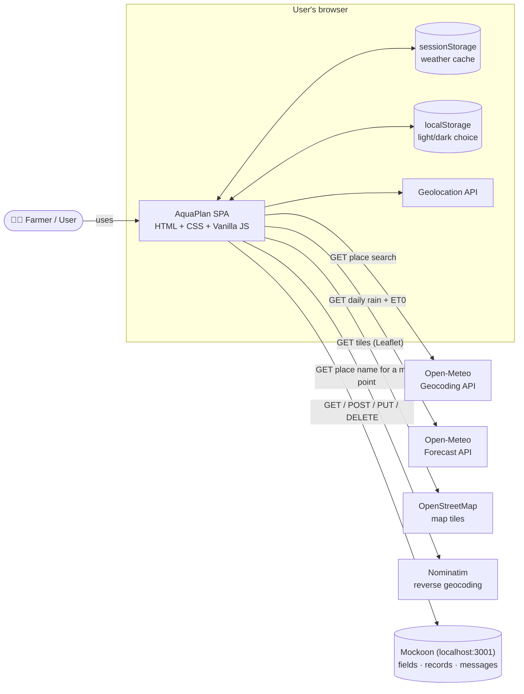

---

## 3. Deployment diagram (local only)

Where each piece runs. Everything except the weather and the map runs on one computer.

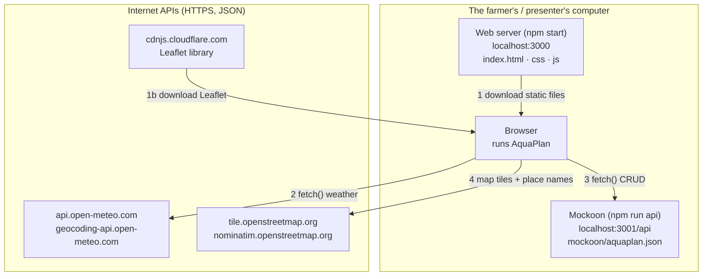

The web server only serves files; it runs no code. **Mockoon** is a mock REST API: it answers
GET/POST/PUT/DELETE from its data buckets (in memory, reset when Mockoon restarts). CORS is on, so the
page on port 3000 may call port 3001. There is **no public deployment**: the app only works on a
computer that runs both servers.

---

## 4. Layered (logical) architecture

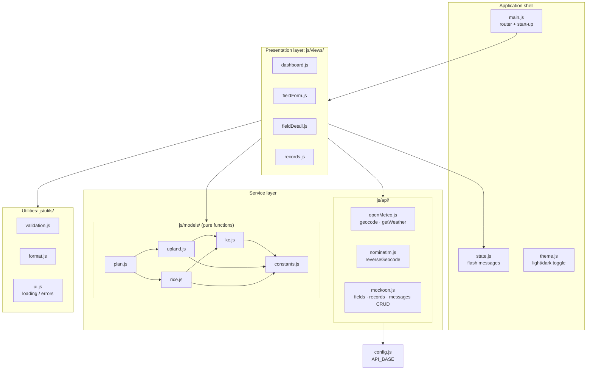

### Module responsibilities

| Module | Responsibility | May use | Must NOT use |
|---|---|---|---|
| `main.js` | Listens for `hashchange` and calls the matching view | views | fetch directly |
| `views/*` | Build HTML, handle events, call services, show loading/errors | api, models, utils, state | — |
| `api/openMeteo.js` | Build Open-Meteo URLs, fetch, reshape arrays into day objects, cache | config, `sessionStorage` | DOM |
| `api/nominatim.js` | Map point → place name, cached in memory (usage policy: ≤ 1 request/second) | `http.js` | DOM |
| `api/mockoon.js` | One function per CRUD action, throw on non-2xx, mark "server not running" | config | DOM |
| `models/*` | Kc, water balance, projection, plan statuses | constants | DOM, fetch, storage |
| `utils/validation.js` | Return `{field: message}` error maps | — | fetch |
| `utils/format.js` | mm ↔ m³, cm ↔ mm, mm ↔ pump hours, drum timing → m³/h, formatting | — | — |
| `utils/ui.js` | Spinner, error banner, empty state, HTML escaping | DOM | fetch |
| `state.js` | Hold a one-time "flash" message (e.g. "Field saved") to show on the next page | — | — |
| `theme.js` | Light/dark toggle button, saves the choice in `localStorage` | DOM | fetch |

---

## 5. Routing map

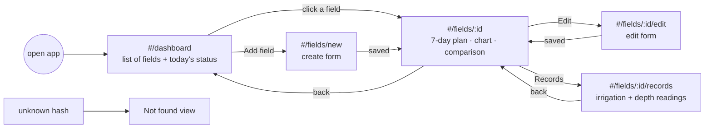

---

## 6. Data architecture (Mockoon)

### 6.1 Entity-relationship diagram

One **field** has many **records**. A record is either an irrigation event or a rice depth reading.

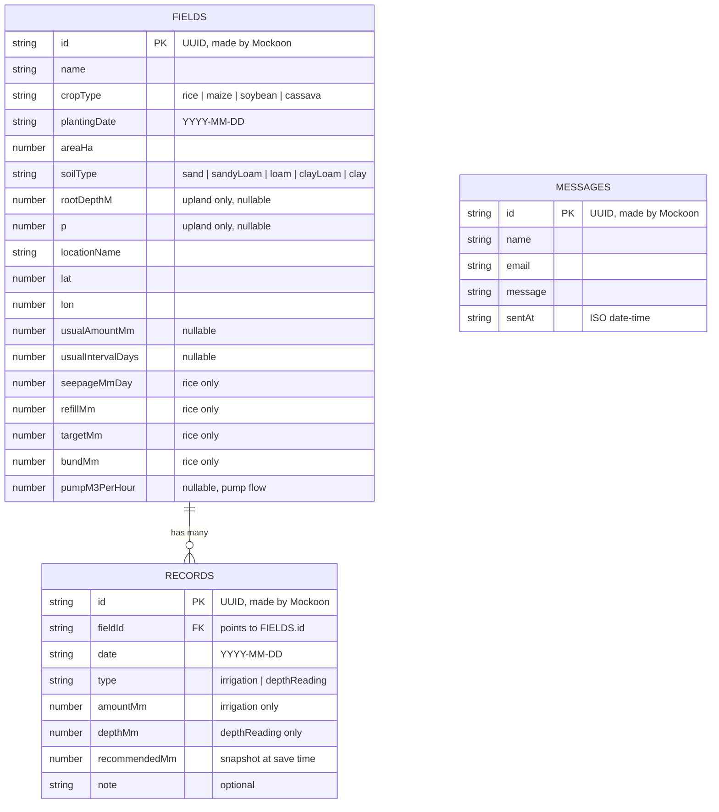

`messages` (contact form) is not linked to fields.

### 6.2 What is stored vs what is calculated

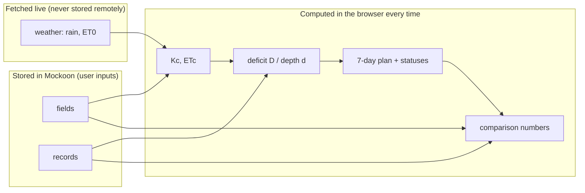

Because derived values are never saved, editing or deleting a record can never leave the stored
data inconsistent. The next page load simply recalculates.

### 6.3 Endpoint map

Base URL: `http://localhost:3001/api` (`API_BASE` in `js/config.js`). Each path is a Mockoon **CRUD route** backed by a data bucket.

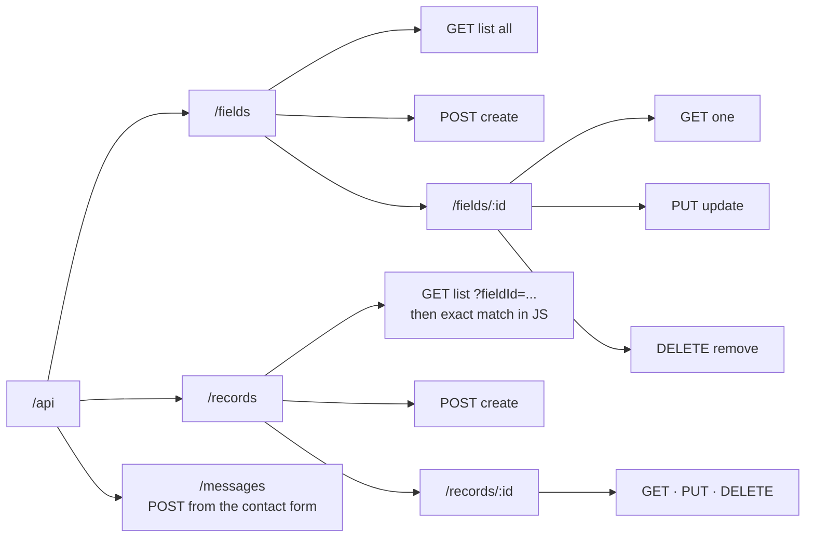

| Method | Path | Body | Success | Used by |
|---|---|---|---|---|
| GET | `/fields` | – | 200 + array | dashboard |
| GET | `/fields/:id` | – | 200 + object | detail, edit form |
| POST | `/fields` | field JSON (no id) | 200 + created object with a new `id` | new form |
| PUT | `/fields/:id` | full field JSON | 200 + updated object | edit form |
| DELETE | `/fields/:id` | – | 200 | detail (after deleting its records) |
| GET | `/records?fieldId=:id` | – | 200 + array (**filtered exactly in JS**, whatever the server does with the filter) | detail, records |
| POST | `/records` | record JSON | 200 | records |
| PUT | `/records/:id` | full record JSON | 200 | records |
| DELETE | `/records/:id` | – | 200 | records |
| POST | `/messages` | `{ name, email, message, sentAt }` | 200 | contact page |

---

## 7. Key interaction sequences

### 7.1 Create a field (with location search)

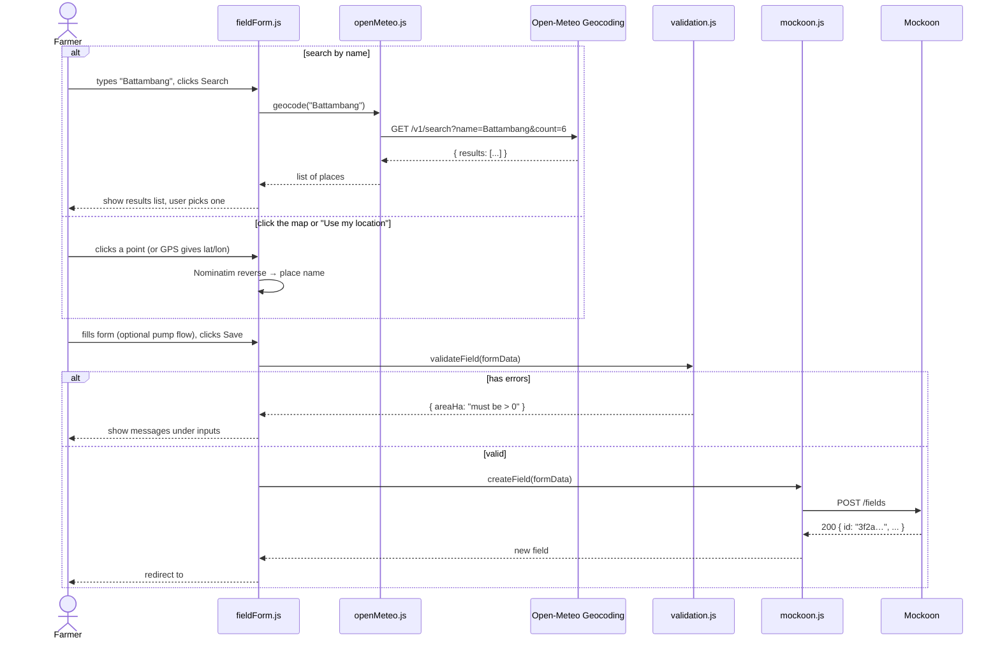

### 7.2 Open a field's detail page (the main flow)

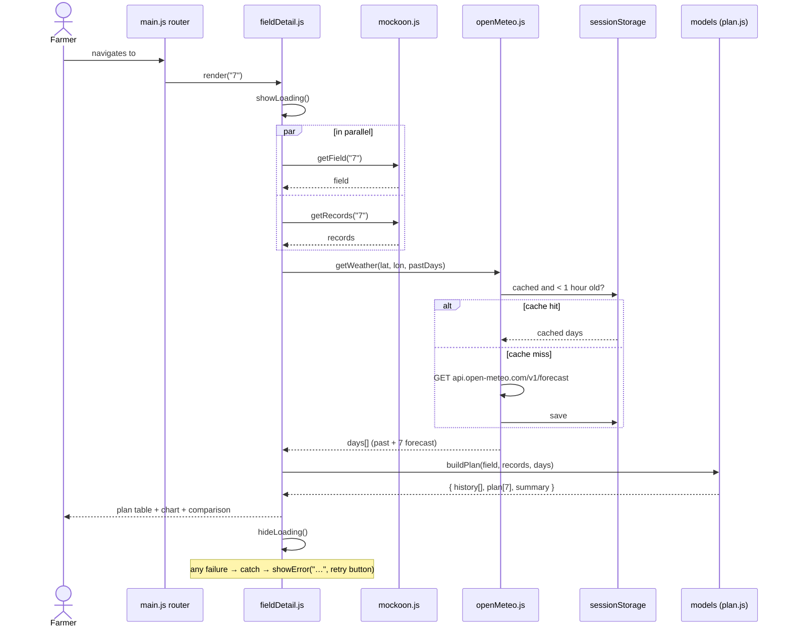

### 7.3 Add an irrigation record

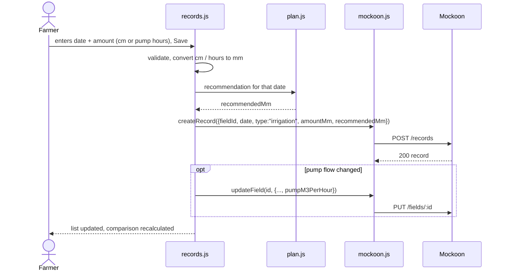

### 7.4 Delete a field (manual cascade)

Mockoon CRUD routes don't know that records belong to a field, so the app deletes them first:

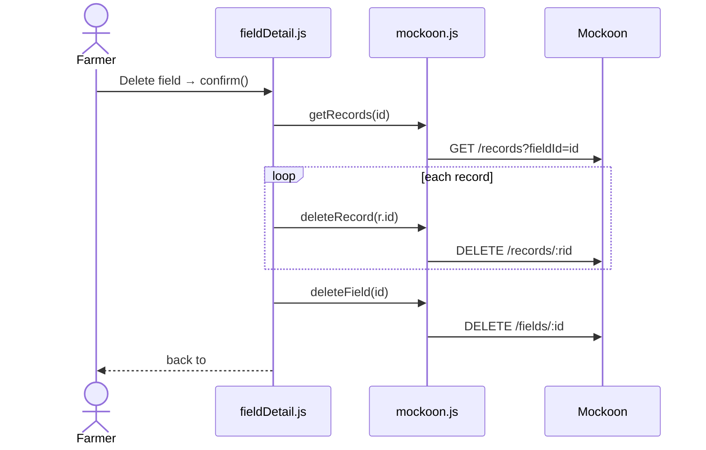

---

## 8. Calculation pipeline

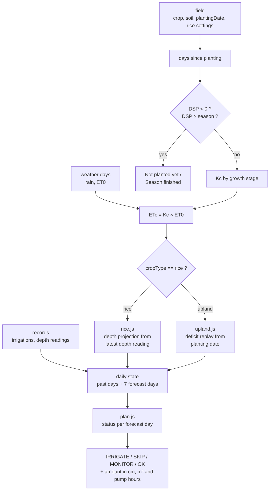

### Daily status decision

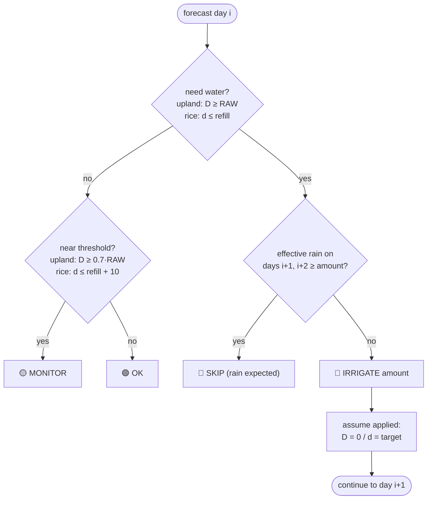

---

## 9. Error handling strategy

| Failure | Where caught | What the user sees |
|---|---|---|
| Mockoon not running (`fetch` to localhost:3001 rejects) | `mockoon.js` marks it `API_OFFLINE` → view | "Can't reach AquaPlan's data server. Start the Mockoon environment…" + **Try again** |
| No internet (Open-Meteo `fetch` rejects) | view `try/catch` | "Network error. Check your internet connection…" + **Try again** |
| Mockoon 404 on `/fields/:id` | view | "Not found. It may have been deleted." |
| 404 on a list | `mockoon.js` | Treated as an empty list `[]` |
| 5xx | view | "The service is having problems right now." + **Try again** |
| Open-Meteo error / missing `daily` | view | Field info still shown. Plan area says "Weather unavailable" |
| Geocoding has no `results` | form | "No places found, try another spelling." |
| Nominatim fails for a map click | form | The coordinates are used as the place name |
| GPS denied or unavailable | form | "Could not get your location. Tap the map instead." |
| Leaflet / map fails to load | form | "The map could not load… Use the search below instead." |
| Validation errors | form | Messages under each input. Nothing is sent |
| Rice field with no depth reading | detail | "Enter today's water depth to see a plan" + input |

All API wrappers **throw** on a non-2xx status. Views decide how to show the error. That keeps the
messages in one place and the API code simple.

---

## 10. Security and limitations (state these in your report)

- Data is stored by **Mockoon on the local computer** only, so nobody on the internet can read or change it.
- Data is kept in memory and **reset when Mockoon restarts** (use "Load demo data").
- No authentication. Everyone using the same computer shares one dataset.
- Local only: there is no public link; a demo needs both servers running.
- User-typed text is shown with `textContent` (or escaped) to prevent HTML/script injection.
- Calculations are simplified FAO-56 defaults, **not** agronomic advice.
- Open-Meteo's free tier has request limits, so weather is cached for 1 hour.
- Nominatim allows about 1 request per second, so map-click names are cached (≈100 m grid).
